# SAM3D Metric Pipeline

A production-ready pipeline that turns a **single RGB-D frame** into a **metrically accurate, textured 3D mesh** of an object. It combines [SAM3D](https://github.com/meta/SAM3D) (single-image 3D generation) with a multi-stage metric alignment engine to produce real-world-scale reconstructions suitable for robotics, AR, and digital-twin applications.

> SAM3D generates complete 3D geometry from one photo, but its output lives in a normalized coordinate space with no physical scale. This pipeline bridges that gap — recovering true metric dimensions from an RGB-D anchor and aligning the full SAM3D mesh into a real-world coordinate system.

## Pipeline Overview

```
RGB Image + Depth Map + Object Mask + Camera Intrinsics K
                          │
              ┌───────────┴───────────┐
              ▼                       ▼
       Anchor Branch            SAM3D Branch
   (metric visible surface)  (complete 3D shape)
              │                       │
              └───────────┬───────────┘
                          ▼
              Metric Alignment Engine
         PCA rotation search × 4 flips
          × 5 scale perturbations (20 candidates)
                          │
                          ▼
            Visible-Surface Rigid ICP
                          │
                          ▼
          3-Stage Scale Correction
          (camera-XY → projection-bbox → PCA object-frame)
                          │
                          ▼
           Multi-Metric Best-Candidate Scoring
     (Chamfer + IoU + Depth MAE + Coverage + Size Error)
                          │
                          ▼
                  Output Artifacts
     metric mesh (.ply/.obj/.glb) + point clouds + metrics JSON
```

## Key Features

- **Single-frame input** — one RGB image, one depth map, one object mask, one camera intrinsic matrix.
- **True metric scale** — reconstructed meshes have real-world dimensions (cm-level accuracy on typical objects).
- **Complete geometry** — SAM3D hallucinates occluded surfaces; the pipeline preserves this while adding metric scale.
- **V1 (point-cloud-to-mesh)** and **V2 (native mesh alignment)** strategies — V2 applies the metric transform directly to SAM3D's native textured mesh, producing smoother, texture-preserving results.
- **HTTP service mode** — Flask-based API with `/reconstruct`, `/load_model`, `/release`, and `/health` endpoints. Accepts file paths or base64-encoded images.
- **Docker-ready** — CUDA 12.1 + PyTorch 2.5 + flash-attn + PyTorch3D, fully containerized with Docker Compose.
- **Reproducible** — deterministic seed control, JSON metrics and timing logs for every run.

## Sample Results

### Input (single RGB-D frame)

| RGB | Mask | Depth |
|:---:|:----:|:-----:|
| 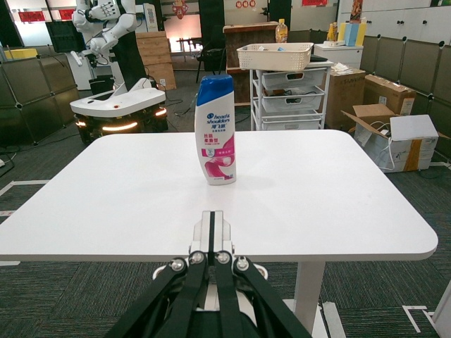 | 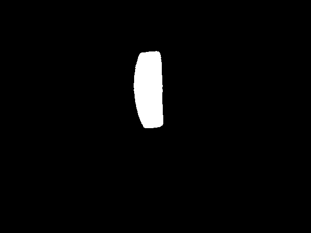 | 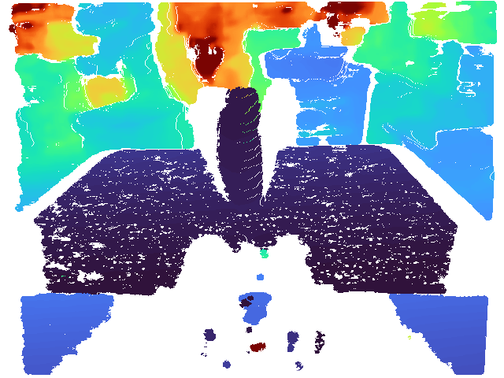 |

### V2: Native Mesh Alignment (textured)

V2 applies the metric transform directly to SAM3D's native mesh, preserving full texture and topology.

| Soda Cookie | Shampoo | Medicine | Mouse |
|:-----------:|:-------:|:--------:|:-----:|
| 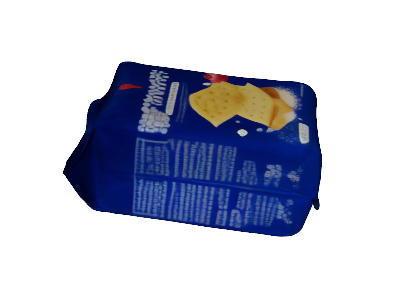 | 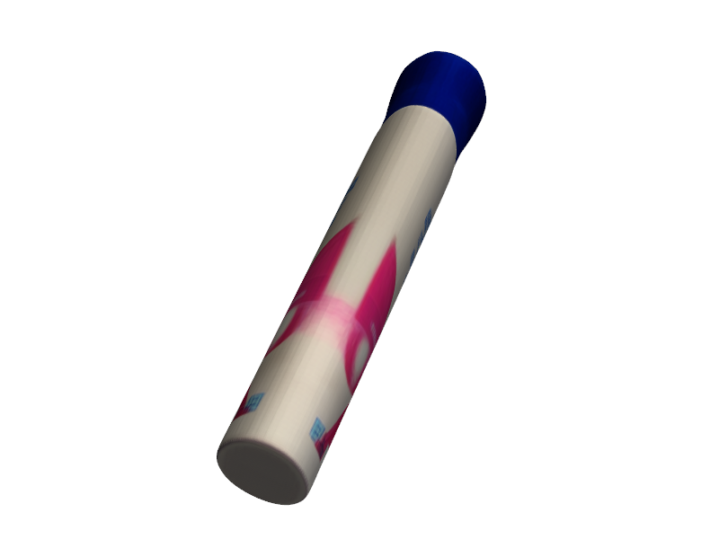 | 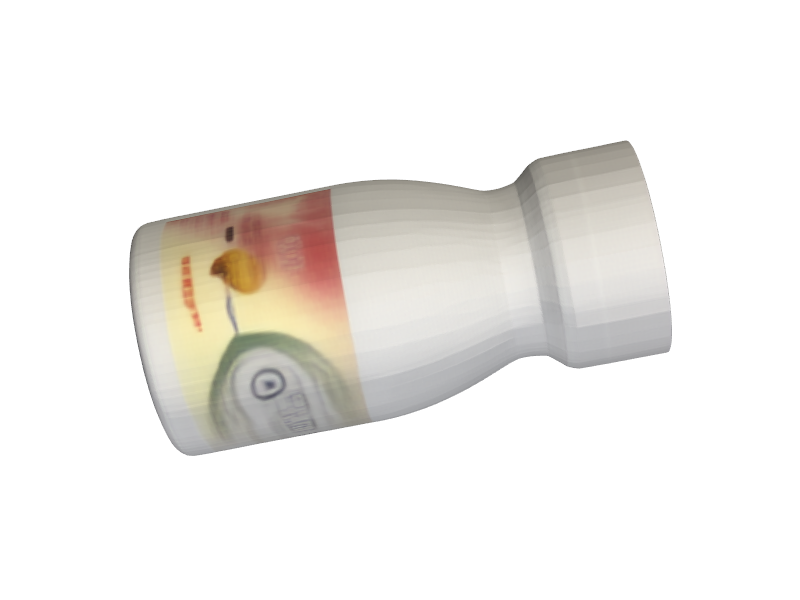 | 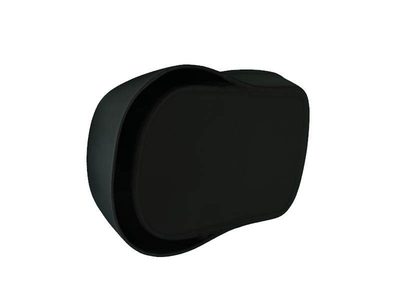 |

### V1: Point-Cloud-to-Mesh (geometry only)

V1 reconstructs meshes via Poisson surface reconstruction from the aligned point cloud. No texture, but watertight geometry.

| Soda Cookie | Phone | Cookie | Ice Tea | Battery |
|:-----------:|:-----:|:------:|:-------:|:-------:|
| 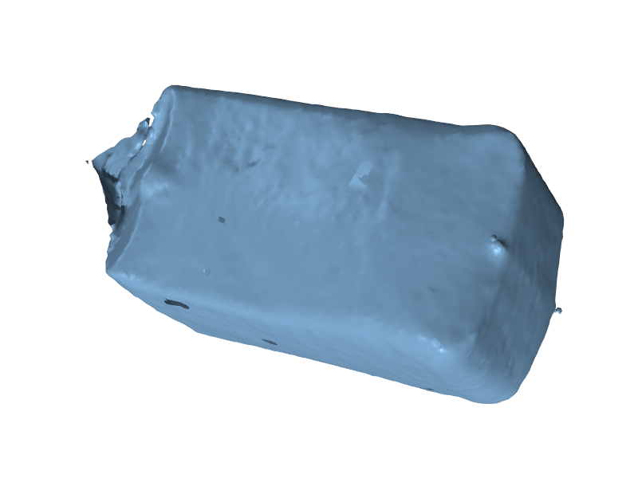 | 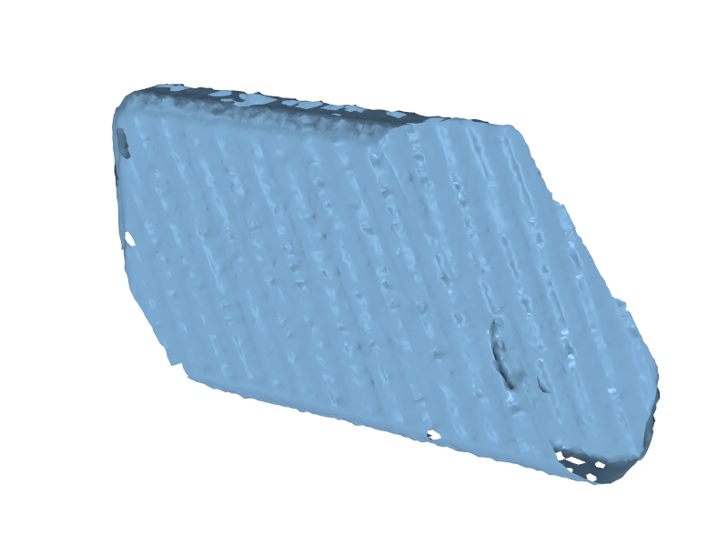 | 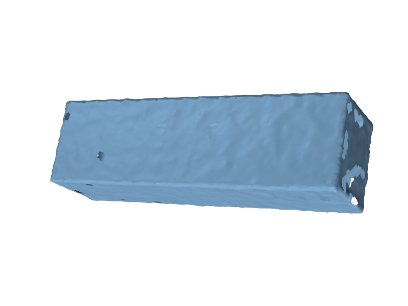 | 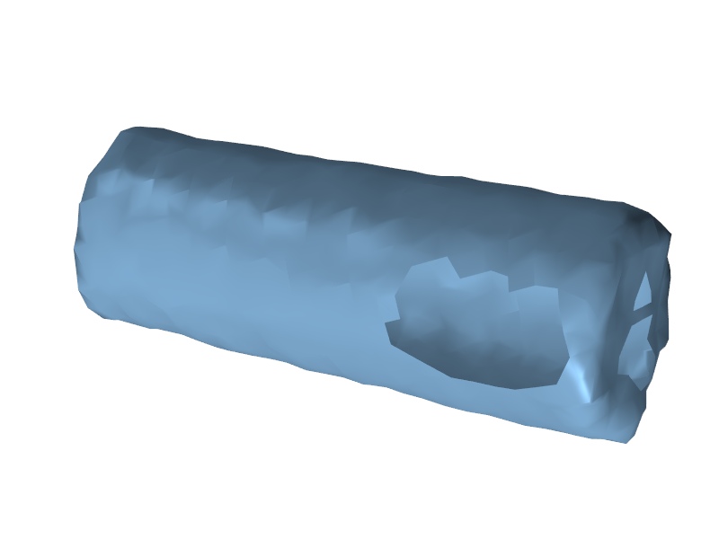 | 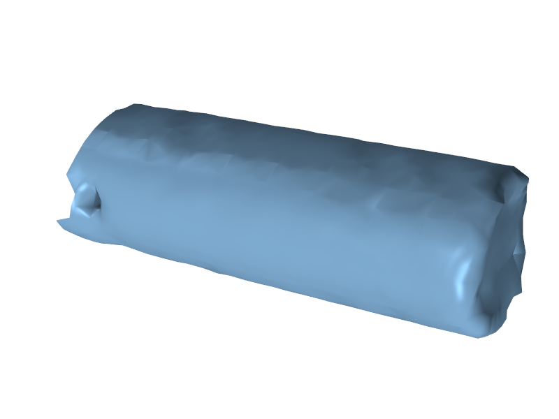 |

### V1 vs V2 Comparison (same object: Soda Cookie)

| V1 (Poisson mesh, geometry only) | V2 (Native SAM3D mesh, textured) |
|:--------------------------------:|:--------------------------------:|
|  |  |

### Quantitative Results (V1 pipeline)

| Object | Target Size (W x H) | Reconstructed Size (W x H) | Mask IoU | Depth MAE (m) | Total Time |
|--------|:-------------------:|:--------------------------:|:--------:|:-------------:|:----------:|
| Battery | 1.74 x 5.09 cm | 1.91 x 5.01 cm | 0.780 | 0.008 | 27s |
| Cookie | 21.74 x 9.70 cm | 22.03 x 9.73 cm | 0.600 | 0.025 | 67s |
| Phone | 11.69 x 15.87 cm | 11.82 x 14.77 cm | 0.596 | 0.002 | 61s |
| Ice Tea | 1.74 x 5.09 cm | 1.96 x 5.00 cm | 0.622 | 0.003 | 16s |

> Dimensions are the metric width x height recovered by the pipeline. Total time includes SAM3D inference (~10-18s) + alignment + mesh reconstruction on a single GPU.

Pre-computed output meshes for V1 and V2 are available under [`outputs/`](outputs/).

## How It Works

### Anchor Branch

Builds a metric-scale visible-surface point cloud from the RGB-D input:

1. **Mask preprocessing** — morphological open/close + largest connected component extraction
2. **Depth unit inference** — auto-detects mm vs. meters
3. **Adaptive erosion** — shrinks mask boundaries to avoid depth noise at edges
4. **Scale target estimation** — computes real-world width/height via pinhole projection: `metric_w = px_w * z_median / fx`
5. **Anchor point cloud** — depth-to-3D projection within a tight depth band around the object

### SAM3D Branch

Runs SAM3D inference to generate a complete (but normalized-scale) 3D point cloud and native mesh from the RGB image + mask.

### Metric Alignment Engine

Aligns the SAM3D output to the anchor using a search-and-refine approach:

1. **PCA frame alignment** — computes principal axes for both clouds, constructs initial rotation with 4 sign-flip candidates
2. **Scale initialization** — solves isotropic scale from XY extents, tested at 5 perturbation levels (0.94x to 1.06x)
3. **Visible-surface extraction** — uses hidden point removal so ICP only aligns what the camera can see
4. **Rigid ICP refinement** — point-to-point ICP with strict isotropic-only constraint (no anisotropic distortion)
5. **3-stage scale correction**:
   - Camera-frame XY correction (clipped to +/-6%)
   - Projection-bbox correction (conservative, shrink-only, max -3%)
   - PCA object-frame correction (final dimension tuning)
6. **Multi-metric scoring** — ranks all 20 candidates by a weighted combination of size error, Chamfer distance, mask IoU, depth MAE, coverage, and ICP fitness

### V1 vs V2 Strategy

| | V1: Point-Cloud-to-Mesh | V2: Native Mesh Alignment |
|---|---|---|
| Approach | Align point cloud, then Poisson reconstruct mesh | Align point cloud, then transfer transform to SAM3D's native mesh |
| Mesh quality | Depends on point density; can have holes | Preserves SAM3D's original topology and texture |
| Texture | No texture (geometry only) | Full texture from SAM3D |
| Use case | When you need a clean watertight mesh | When visual quality matters |

## Project Structure

```
SAM3D_metric/
├── src/
│   ├── reconstrcution/metric_V1/    # Core reconstruction class (SAM3DReconstructor)
│   ├── service/                     # Flask HTTP service wrapper
│   └── utils/                       # Config loading and logging
├── libs/SAM3D/                      # SAM3D model (submodule)
├── docker/                          # Dockerfile + Compose for GPU deployment
├── test_data/                       # Sample RGB / depth / mask inputs
├── outputs/                         # Pre-computed reconstruction results (V1, V2, V2.5)
├── config.yaml                      # Logger configuration
└── scripts/                         # Start/stop helpers
```

## Quick Start

### Python API

```python
from src.reconstrcution.metric_V1.sam3D_class_V1 import SAM3DReconstructor

reconstructor = SAM3DReconstructor(
    sam3d_root="/path/to/SAM3D",
    sam3d_config="/path/to/checkpoints/pipeline.yaml",
    out_dir="./output",
)

result = reconstructor.recon(
    rgb_path="test_data/images/77.png",
    depth_path="test_data/depth/77.png",
    mask_path="test_data/mask/77.png",
    k_input=[384.9, 0.0, 326.9, 0.0, 384.5, 240.4, 0.0, 0.0, 1.0],
)

print(result["metric_mesh_ply_path"])  # → ./output/sam3d_metric_general_mesh.ply
```

### HTTP Service

```bash
# Start the service
docker compose -f docker/compose.yaml up -d

# Health check
curl http://localhost:5000/health

# Load model
curl -X POST http://localhost:5000/load_model

# Reconstruct
curl -X POST http://localhost:5000/reconstruct \
  -H "Content-Type: application/json" \
  -d '{
    "rgb_path": "/workspace/test_data/images/77.png",
    "depth_path": "/workspace/test_data/depth/77.png",
    "mask_path": "/workspace/test_data/mask/77.png",
    "k_input": [384.9, 0.0, 326.9, 0.0, 384.5, 240.4, 0.0, 0.0, 1.0]
  }'

# Release GPU memory
curl -X POST http://localhost:5000/release
```

### Docker Deployment

```bash
# Build (requires NVIDIA GPU + Docker with nvidia-container-toolkit)
docker compose -f docker/compose.yaml build

# Run
docker compose -f docker/compose.yaml up -d

# The service listens on port 5000 by default
```

The Docker image includes CUDA 12.1, PyTorch 2.5.1, flash-attn 2.8.3, PyTorch3D, and all SAM3D dependencies. Model checkpoints should be mounted at `/workspace/checkpoints/pipeline.yaml`.

## Configuration

### Environment Variables

| Variable | Default | Description |
|----------|---------|-------------|
| `SAM3D_PROJECT_ROOT` | auto-detected | Project root directory |
| `SAM3D_ROOT` | `libs/SAM3D` | Path to SAM3D source |
| `SAM3D_CONFIG` | `checkpoints/pipeline.yaml` | SAM3D model config |
| `SAM3D_SERVICE_PORT` | `58860` | HTTP service port |
| `SAM3D_OUTPUT_ROOT` | `Outputs/service_outputs` | Default output directory |
| `SAM3D_PRELOAD_MODEL` | `0` | Load model on startup |
| `SAM3D_VOXEL_SIZE` | `0.003` | Voxel downsampling size (m) |
| `SAM3D_ICP_MAX_ITER` | `40` | ICP maximum iterations |
| `SAM3D_RELEASE_AFTER_RECON` | `0` | Free GPU after each reconstruction |

### SAM3DReconstructor Parameters

| Parameter | Default | Description |
|-----------|---------|-------------|
| `voxel_size` | 0.003 | Point cloud downsampling voxel size |
| `icp_max_iter` | 40 | ICP refinement iterations |
| `mesh_poisson_depth` | 8 | Poisson reconstruction depth (V1) |
| `mesh_density_q` | 0.02 | Poisson density cutoff quantile |
| `sam_compile` | False | Compile SAM3D model (slower init, faster inference) |

## Output Artifacts

Each reconstruction produces:

| File | Description |
|------|-------------|
| `*_full.ply` | Full metric-aligned point cloud |
| `*_visible.ply` | Visible-surface metric point cloud |
| `*_mesh.ply` / `*_mesh.obj` | Reconstructed metric mesh |
| `*_mesh_axis_aligned.ply` | PCA axis-aligned mesh (longest axis = Y) |
| `anchor_*.ply` | RGB-D anchor point cloud |
| `sam3d_raw_*.ply` | Raw SAM3D output (normalized scale) |
| `best_alignment_metrics.json` | Alignment quality metrics |
| `timings.json` | Per-step timing breakdown |

## Limitations

- **Single-view** — accuracy depends heavily on frame selection (object centered, minimal occlusion, near-frontal view)
- **Thickness excluded** — Z-axis scale is not directly constrained; objects where thickness is the primary dimension may be less accurate
- **Reflective surfaces** — depth maps from reflective objects are noisy, degrading anchor quality
- **Metric anchor approximation** — width/height derived from 2D bounding box + median depth; oblique views introduce systematic error

## Acknowledgments

This pipeline builds on [SAM3D Objects](https://github.com/facebookresearch/sam-3d-objects) by Meta Research for single-image 3D generation. The metric alignment strategy is inspired by [Any6D](https://arxiv.org/abs/2401.10082) for anchor-driven scale recovery, adapted with engineering-oriented multi-stage refinement.

## License

See [LICENSE](libs/SAM3D/LICENSE) for the SAM3D model license. Pipeline code in `src/` is provided as-is.
